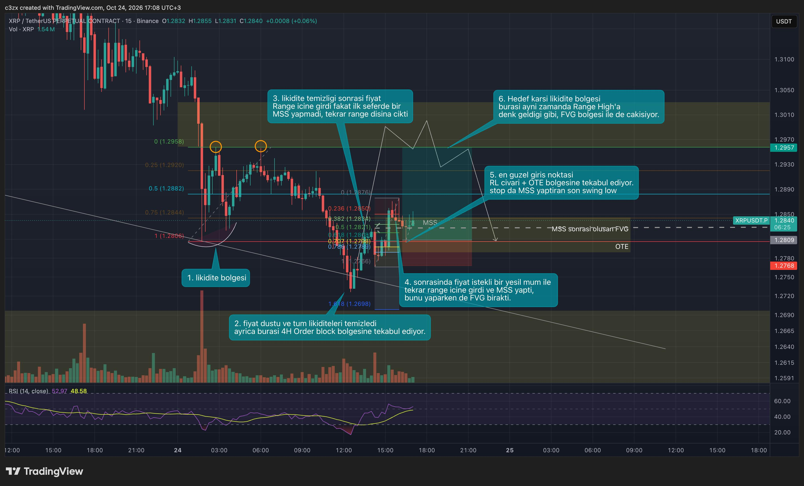

# 02 — Kurulum: süpürme → MSS → FVG %50 → karşı likidite

Arkadaşının kendi cümleleriyle: *"Süpürme fark etmez, yeter ki süpürsün. Süpürdükten sonra ters tarafa LTF'de bir
MSS beklerim. MSS yaparken de FVG bırakmasını. Sonra o FVG'nin %50'sinden girmek isterim. Eğer bir range varsa RH ya
da RL'dan girerim. Üst dilim yapısı yönünde işlem almak her zaman en iyisi. Eğer terse işlem alınacaksa 0,5R riske
etmeli."*

## Adımlar

1. **Likidite bölgesini bul (HTF).** XRP'de iki eşit tepe (turuncu daireler, 1,2958) ve aşağıda eski dipler. Bölge
   mümkünse 4H FVG/OB ile çakışsın (örnekte düşüşün bittiği yer "4H order block bölgesi").
2. **Süpürmeyi bekle.** Fiyat düştü, alttaki likiditeleri temizledi (eski diplerin altına fitil). Bu anda işlem yok;
   sadece "süpürdü" notu.
3. **Yanlış başlangıcı tanı.** Fiyat range içine girdi ama **MSS yapmadı**, tekrar dışarı çıktı. Arkadaşı burada
   beklemiş. Acele edenin kaybettiği yer burası.
4. **MSS + FVG.** İstekli bir yeşil mum range içine girdi, son küçük tepeyi kapanışla kırdı (**MSS**) ve arkasında
   bir **FVG** bıraktı.
5. **Giriş.** FVG'nin %50'si (kesikli çizgi). Örnekte bu seviye range dibi (RL) ve **OTE** (0,705–0,786) ile çakışıyor:
   "en güzel giriş noktası". **Stop:** MSS'i yapan hareketin başladığı son swing dip (süpürme fitilinin altı).
   Limit emirle gir, mum kapanışını bekle (alt dilimde onayla erken girilebilir ama kural kapanış).
6. **Hedef.** Karşı likidite = range tepesi (1,2957); üstelik orada bir FVG var (çakışma). R:R örnekte ≈ 3.

## Range kuralı
Fiyat belirgin bir range'deyse (trend yok): girişler **range dibi (RL) ve tepesi (RH)** civarında aranır; süpürme bu
uçlarda olur, hedef karşı uç. Range ortasında (0,5 civarı) işlem yok.

## Kontrol listesi (hepsi evet olmalı)
- [ ] Günlük ve 4H yön belli; işlem bu yönde mi? (Ters ise yarım boy: 0,5R.)
- [ ] Süpürülen seviye gerçek likidite mi (eşit tepe/dip, PDH/PDL, seans, eski swing)?
- [ ] Süpürmeden sonra **kapanışla** MSS geldi mi? (Süpürmeden sonra 1H'de 12, 4H'de 6 mum içinde; gecikirse iptal.)
- [ ] MSS bacağında FVG var mı? Giriş %50'si; mümkünse OTE/OB/RL ile çakışıyor mu?
- [ ] Stop son swing'in ötesinde ve risk hesap büyüklüğünün %1'i mi?
- [ ] Karşı likidite hedefi **en az 2–2,5R** uzakta mı? Değilse işlem yok.
- [ ] Alacağın yönde RSI uyumsuzluğu yok mu? USDT.D (bizde BTC eğilimi) ters değil mi?
- [ ] Hafta sonu / killzone değil mi? Haber saati değil mi?
- [ ] Açık işlem sayısı < 2 mi? Bugünkü kayıp 2–3R'nin altında mı?

## Pas geçme nedenleri (arkadaşının sıraladıkları)
- Alacağı yönde RSI uyumsuzluğu var.
- USDT.D yönü desteklemiyor.
- Süpürdü, geri kapattı ama **ters yönde alınacak likidite yok** (hedef yok → işlem yok ya da temkinli).
- Fiyat seviyeye çok sert geldi, hacim/RSI desteklemiyor (manipülasyon).

## Sık hata
- Süpürmeyi görür görmez girmek (MSS'siz). Örnekte 3. adım tam bu.
- FVG'nin kenarından değil ortasından girmek kuralken, FOMO ile kenarından girmek: stop mesafesi uzar, R:R düşer.
- Stopu MSS'i yapan swing'in **içine** koymak: normal geri test stop yer.
- Hedefi "hissederek" uzatmak; hedef likidite, bitince biter.
