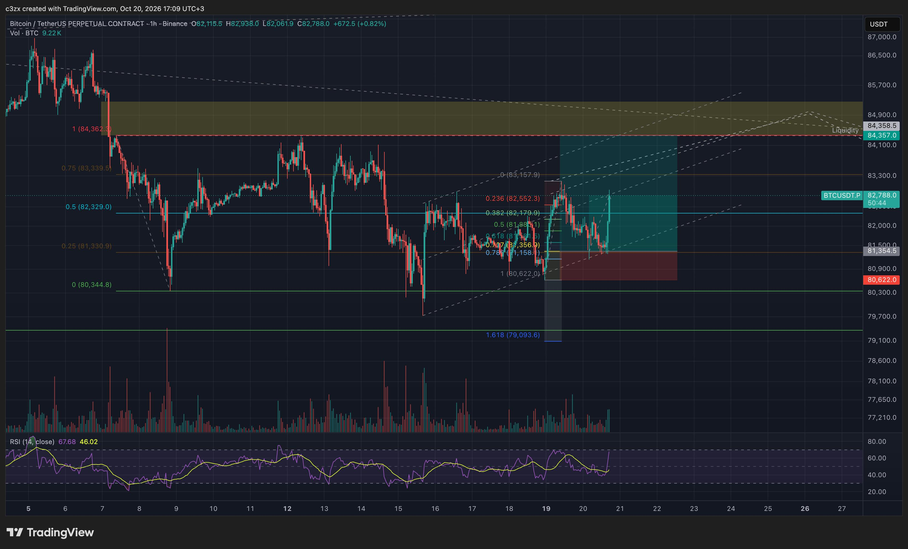
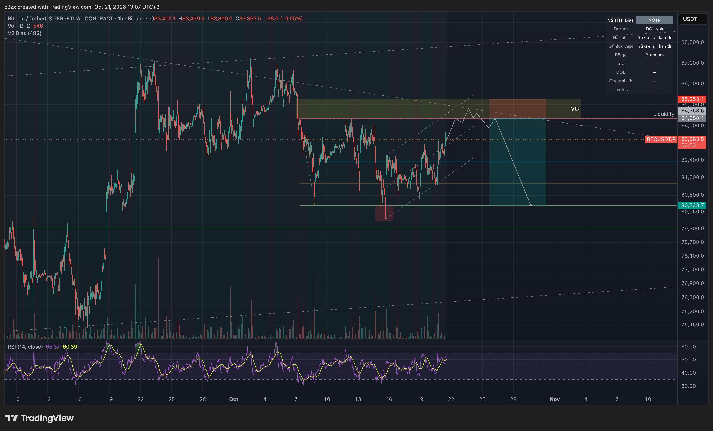
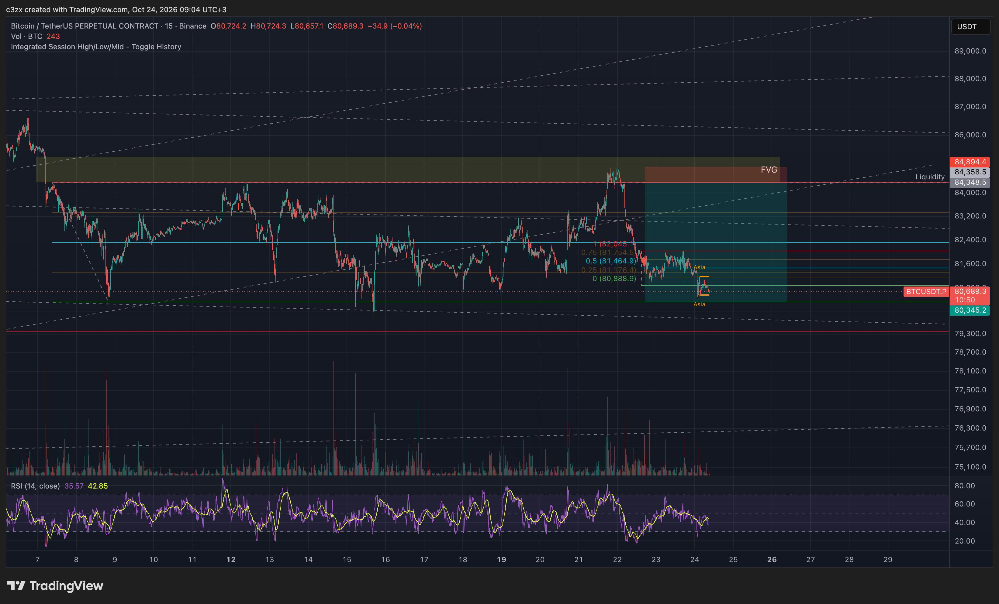
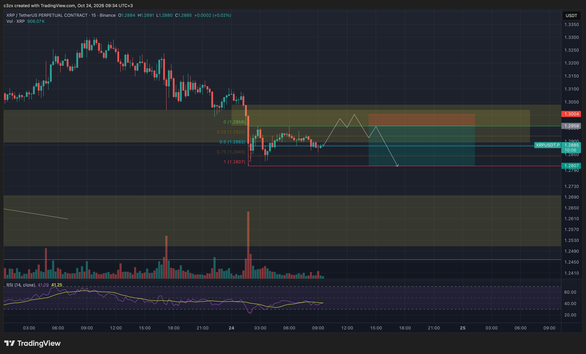
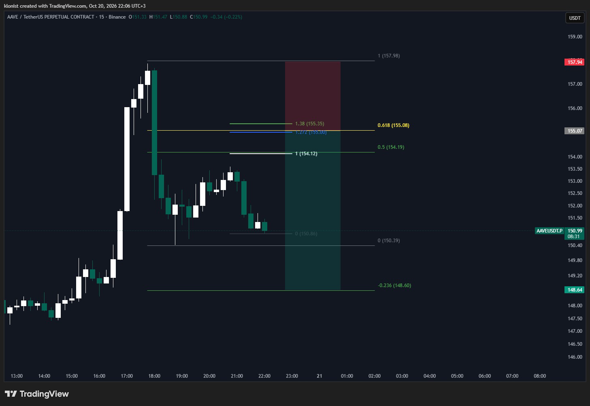
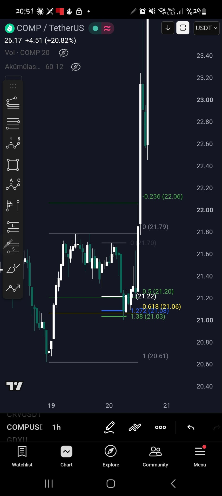
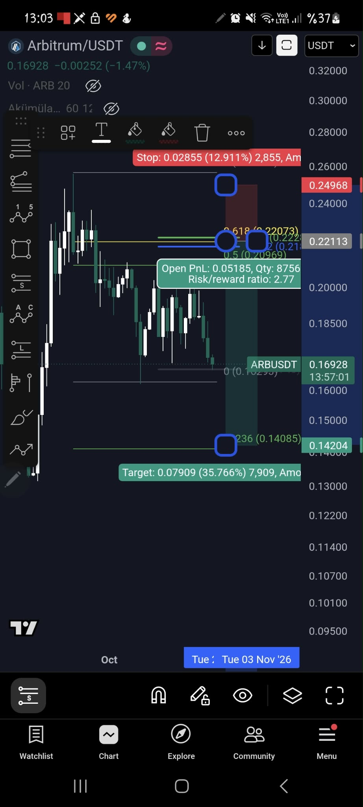

# 04 — Örnekler (arkadaşının grafikleri)

Her örnekte: bağlam → likidite → tetik → giriş/stop/hedef → ne oldu. Tarihler Ekim 2026.

## A. BTC 1H: long (20 Ekim) → short (21–24 Ekim) dizisi

### A1. Long, 20 Ekim 17:09

- **Bağlam:** 7 Ekim'deki sert düşüşün (84.362 → 80.344) çeyrek fibinde fiyat 0,25–0,5 arasında → **discount**.
  Yukarıda sarı kutu (düşüşün bıraktığı FVG, 84.360–84.900) ve "Liquidity" 84.358 (eşit tepeler).
- **Bacak:** 80.622 → 83.157 yükseliş; geri çekilme. Bu bacağın fibi: 0,618 = 81.595, **0,705 = 81.356**, 0,786 = 81.158.
- **Giriş:** 81.354 (OTE 0,705). **Stop:** 80.622 altı (bacağın dibi; risk 732). **Hedef:** 84.357 (likidite; 3.003).
  **R:R ≈ 4,1.**
- **Ne oldu:** fiyat 82.788'e yükselmiş (ok), 21 Ekim'de 83.363, 22 Ekim'de 84.400 → hedef görüldü.

### A2. Short planı, 21 Ekim 13:07

- **Bağlam:** panel "V2 HTF Bias": haftalık ve günlük yapı yükseliş, ama **bölge premium**, yükselen kanal daralıyor.
  Yukarıda eşit tepeler (84.350) ve FVG (84.350–85.253).
- **Senaryo:** fiyat eşit tepeleri **süpürür**, FVG'ye girer, reddedilir; sonra 80.338'e (alt likidite) iner.
- **Giriş:** FVG içi (~84.350–85.000). **Stop:** 85.253 (FVG üstü). **Hedef:** 80.338. **R:R ≈ 4,4.**
- Not: aynı seviye A1'in hedefiydi. Bir senaryo bitince ters yönde yenisi başlar: likidite alındı → tuzak → dönüş.

### A3. Sonuç, 24 Ekim 09:04 (15m)

- 22 Ekim: fitil 84.358'in üstüne (süpürme), sert dönüş. 24 Ekim: 80.689, hedefe (80.345) birkaç yüz dolar.
- "Asia" işaretleri: seans dibi süpürülmüş. Yeni çeyrek fib son düşüşe çekilmiş.
- İki işlem üst üste ≈ 4R + ≈ 4R. **Uyarı:** bu bir haftalık dilim; arşivde çalışmayanlar da var.

## B. XRP 15m: planlı short (24 Ekim 09:34) ve işaretli örnek (24 Ekim 17:08)

- Sert düşüş 1,3004 → 1,2807, geride FVG (1,2958–1,3050). Çeyrek fib: 0,5 = 1,2882, fiyat tam orada (denge).
- **Senaryo:** FVG'ye tepki (1,2958–1,30), ret, dibe (1,2807) dönüş. **Giriş** 1,2958, **stop** 1,3004, **hedef**
  1,2807 → **R:R ≈ 3,3.**

- Aynı gün öğleden sonra, işaretli 6 adım (02-kurulum.md'de ayrıntı): likidite → süpürme (4H OB) → MSS'siz yanlış
  giriş → istekli mumla MSS + FVG → giriş FVG %50 = RL + OTE → hedef range tepesi + FVG. Long, hedef 1,2957.

## C. Fib kesişimi (0,618 × 1,272) — arkadaşının diğer kuralı
Önceki (büyük) itkinin 0,618 geri çekilmesi ile düzeltmenin ilk bacağı A'nın B'den 1,272 uzantısı aynı yerde.
Yön itkinin yönü. (Tarayıcıda "Fib kesişimi" preseti.)

| | İtki | 0,618 | A bacağı | B'den 1,272 | Yön | Stop / hedef |
|---|---|---|---|---|---|---|
| AAVE 15m | 157,98 → 150,39 | 155,08 | 150,86 → 154,12 | 155,00 | short | 157,98 üstü / 148,6 (−0,236) |
| COMP 1H | 20,61 → 21,79 | 21,06 | 21,70 → 21,22 | 21,08 | long | — / fiyat 23+'ya gitti |
| ARB | 0,2497 → 0,163 | 0,2207 | — | 0,2211 | short | 0,2497 / 0,079 |

## Örneklerden çıkan ortak dil
1. Önce **likidite nerede** sorusu; giriş değil, hedef ve tuzak aranır.
2. Giriş hep bir **geri dönüşte** (FVG/OTE), hiç kovalamada değil.
3. Stop yapısal (fitil/swing ötesi), hedef karşı likidite; bu yüzden R:R 3–4.
4. Her senaryo bir **hikâye**: alınan likidite → tuzak → dönüş → karşı likidite. Hikâye bozulursa (MSS yok) beklenir.
